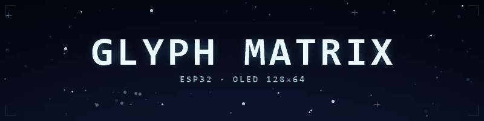

<p align="center">
  
</p>

[Русская версия](README.ru.md) · **English**

ESP32 + OLED 128×64 (SSD1306) firmware inspired by the Nothing Glyph Matrix.
It plays pixel-grid animations, shows a framed menu with snow or stars in the
background, stores animations in LittleFS and serves a local website with a
phone-friendly animation editor.


## Features

- Animations on a **25×25** or **64×64** grid.
- Menu with a frame, section icon and edge arrows.
- Main screen cycles through **Settings → Info → animations**.
- Settings: FPS (1…30), rotation 0/90/180/270, background (snow/stars), editor grid,
  interface language.
- Info screen: project, board, version, grid, FPS, Wi-Fi, site address, memory.
- Animation info: name, FPS, frame count and duration as `frames / FPS`.
- Playback: animation in the centre, info on **up**, pause on **down**,
  stop on **OK**.
- Local access point and website: upload, delete, download and start animations.
- Standalone phone editor: drawing, eraser, round brush, shapes (circle,
  square, rectangle, oval), frame invert, frames, preview, save to the device
  and `.anim` download.
- Built-in animations `PULSE`, `WAVE`, `SCAN`, `SPIRAL` are created on first boot.
- Web pages are embedded into the firmware — no separate filesystem upload.
- The device UI, website and editor all speak **English (default) and Russian**.

## Hardware

| Part | ESP32 pin |
|---|---|
| OLED SDA | GPIO21 |
| OLED SCL | GPIO22 |
| Button "up" | GPIO19 → GND |
| Button "down" | GPIO23 → GND |
| Button "OK" | GPIO18 → GND |

Buttons use `INPUT_PULLUP`: the second contact goes to GND.
The OLED is connected over I2C, usually address `0x3C`, powered from 3.3 V.
The bus runs at 400 kHz.

On boot the firmware probes both SDA/SCL orders, addresses `0x3C` and `0x3D`
and speeds 400/100 kHz, so swapped SDA/SCL does not break anything.

## Build and flash

You need [PlatformIO](https://platformio.org/) (CLI or the VS Code extension).

```powershell
pio run -t upload
pio device monitor
```

Or in VS Code: PlatformIO → Upload.

The board in `platformio.ini` is `esp32doit-devkit-v1` with the Arduino
framework. `default.csv` is used — about 1.4 MB of LittleFS for animations.

Before the build, `scripts/embed_web.py` reads `web/index.html` and generates
`src/web_assets.h`. Edit the website in `web/`, never in the generated header.
The `editor.html` file is not part of the firmware: it is a standalone file for
the phone.

## Wi-Fi and website

After flashing, the device starts an access point:

- **Network:** `GlyphMatrix`
- **Password:** `glyph1234`
- **Website:** <http://192.168.4.1>
- **Hostname:** <http://glyph.local> (mDNS)

Connect the phone to `GlyphMatrix`, open a browser and go to the address.
The same details are shown on the device boot screen (press **OK** to skip).

To connect the ESP32 to your home network as well, fill in `STA_SSID` and
`STA_PASS` in `src/config.h`. The website is then also available on the local IP.

### Website

- Device information, IP, memory, firmware and the current screen.
- Wi-Fi password (`AP_PASS`) and network name.
- FPS, rotation, background, grid and device language settings.
- Animation list: play, download, delete.
- `.anim` upload from a phone or computer.
- **EN / RU** switch in the header: English is the default, Russian is one click
  away and is remembered in the browser. This switch only changes the website;
  the device language is selected in the **Device language** row below.

### Standalone editor `editor.html`

The editor no longer takes space in the firmware. `editor.html` lives in the
repository root: copy it to your phone and open it in a browser, even offline.

- **Device** field — ESP32 address, `http://192.168.4.1` by default.
- Draw with a finger or mouse, brush sizes 1…4, eraser, clear frame.
- Undo and redo (up to 40 steps), shortcuts `Ctrl+Z`, `Ctrl+Y`, `B`, `E`, `Space`.
- Frames: add, duplicate, delete, move left/right.
- Preview with adjustable FPS.
- Grid 25×25 or 64×64 (changing the grid clears the frames).
- **Save** — sends the `.anim` straight to the ESP32 (the phone must be on the
  `GlyphMatrix` network), **On device** — saves and starts it immediately.
- **Download .anim** — saves the file to the phone; it can then be uploaded
  through the device website.
- The drawing is autosaved to the browser `localStorage`.
- **EN / RU** switch in the header, the choice is remembered.

CORS headers are enabled in the firmware, so the editor also works from a local
`file://` page.

## Main menu

The main screen shows an icon and the title of the selected item in the top
frame, with snow or stars in the background.

**Up/down** switch between:

- **SETTINGS**
- **INFO**
- every animation from LittleFS: **PULSE**, **WAVE**, **SCAN**, **SPIRAL**, …

The header of any animation item reads **ANIMATION**. Below it the concrete
animation name is shown in a frame, without the file extension (for example
`PULSE`, not `PULSE.anim`). Uploading a new `.anim` through the website or the
editor adds the item to the menu automatically.

> The on-device UI is English by default. Open **SETTINGS → LANGUAGE** and press
> **OK** to switch to Russian; the choice is stored in NVS. All strings live in
> `src/ui.cpp` and `src/main.cpp` and are translated in place with the `L(en, ru)`
> helper — the built-in font already covers Latin and Cyrillic.

## Buttons

| Screen | Up / Down | OK | Long OK |
|---|---|---|---|
| Main menu | select item | open / play | open / play |
| Settings | select row | enter editing | back |
| Settings (editing) | change the active value | FPS row: switch FPS ↔ rotation; other rows: confirm and exit | confirm and exit |
| Information | scroll | back | back |
| Playback | up — info, down — pause | stop and return to menu | stop and return to menu |

In settings a value changes after pressing **OK**: FPS by 1 frame (1…30),
rotation 0° → 90° → 180° → 270°, background, grid and language toggle
(English ↔ Russian). Holding the button repeats FPS slowly, about 5 values per
second.

**FPS and rotation share one row** (`FPS 24  ROT 0°`) to keep normal row
spacing. Press **OK** to edit FPS, press **OK** again to switch to rotation,
change the active value with up/down, then hold **OK** to confirm and leave
editing. The active value is shown in `<angle brackets>` where they fit.

At 90° and 180° the "up" and "down" buttons are swapped: the one that was
"down" at 0° becomes "up". At 270° the layout stays as at 0°. While editing the
**ROTATION** row the buttons always follow the 0° layout.

## `.anim` format

A file consists of a 16-byte header and the frames:

| Offset | Size | Field |
|---|---|---|
| 0 | 4 | `GLYM` |
| 4 | 1 | version (1) |
| 5 | 1 | grid width (1…64) |
| 6 | 1 | grid height (1…64) |
| 7 | 1 | author FPS (0 = default) |
| 8 | 1 | flags (bit 0 — loop) |
| 9 | 3 | reserved |
| 12 | 2 | frame count, uint16 little-endian |
| 14 | 2 | reserved |
| 16 | … | frames |

A frame is a row-major bitmap: bit `y * width + x`, the least significant bit of
a byte is the first pixel. Frame size: `ceil(width * height / 8)` bytes.

Playback speed on the device is set by the global FPS setting. The FPS stored in
the file is used by the editor as the author's value.

Limits: name up to 24 bytes, up to 512 frames, file up to 256 KB, grid up to
64×64.

## On-screen scaling

- **25×25** is drawn at 2×2: one grid pixel = 4 OLED pixels, i.e. 50×50 dots in
  the centre of the screen.
- **64×64** does not fit into 128×64 when scaled, so it is drawn **1:1**
  (64×64 dots in the centre). That is a limitation of the display itself.

## Project layout

```
platformio.ini          build, dependencies, pre-script
scripts/embed_web.py    embeds the website into src/web_assets.h
web/index.html          website
editor.html             standalone phone editor (not in the firmware)
src/main.cpp            boot, splash, Wi-Fi screen
src/config.h            pins, Wi-Fi, limits
src/gfx.*               OLED wrapper and rotation
src/settings.*          settings in NVS
src/anim.*              .anim format, LittleFS, player
src/background.*        snow and stars
src/buttons.*           debounce, click, long press, auto-repeat
src/web.*               Wi-Fi AP, mDNS, API, file upload
src/ui.*                all screens and button handling
src/font5x7.h           ASCII + Cyrillic font
src/icons.h             8×8 icons
tools/gen_assets.py     font and icon generator
tools/make_banner.py    README starfield banner generator
assets/banner.gif       README banner (generated)
```

## API

| Method | Path | Purpose |
|---|---|---|
| GET | `/api/info` | device state and parameters |
| GET | `/api/settings` | current settings |
| POST | `/api/settings` | change `fps`, `rotation`, `background`, `grid`, `lang` |
| GET | `/api/animations` | animation list |
| GET | `/api/anim?name=NAME` | download a file |
| POST | `/api/anim` | upload `.anim` (multipart, field `file`) |
| DELETE | `/api/anim?name=NAME` | delete |
| POST | `/api/play?name=NAME` | play on the device |
| POST | `/api/stop` | stop |

## Troubleshooting

- **Blank screen.** On boot the firmware tries both SDA/SCL orders, addresses
  `0x3C`/`0x3D` and speeds 400/100 kHz. Check the log:
  `[OLED] display at 0x3C ...` or `[OLED] not found ...`. If nothing is found,
  verify 3.3 V power, GND, wire integrity and the module pins' solder joints.
  If the log says `SDA/SCL swapped`, the firmware already uses the detected order.
- **Buttons do not react.** Make sure the button shorts the pin to GND, not to 3.3 V.
- **Website does not open.** Check that the phone is connected to `GlyphMatrix`.
  If `glyph.local` does not resolve, use `192.168.4.1`.
- **Upload rejected.** The file must be a valid `.anim` (magic `GLYM`, version 1).
  An invalid file never replaces an already saved animation with the same name —
  the server only removes the temporary copy.
- **Animation stutters.** Lower the FPS or the grid size. A full screen update
  over I2C takes about 23 ms, so 30 FPS is the practical limit.
- **Reset settings.** Settings live in NVS; erase the flash if needed:
  `pio run -t erase`.

## License

MIT — see [LICENSE](LICENSE). You are free to use, modify, fork and redistribute
the project; a link back is appreciated.

Nothing Glyph Matrix is a trademark of Nothing Technology Limited. This project
is not affiliated with Nothing and is an independent implementation of the idea.

---

Created with [OpenCode](https://opencode.ai) and DeepSeek 4.1 Flash Free
(fully vibe-coded).
