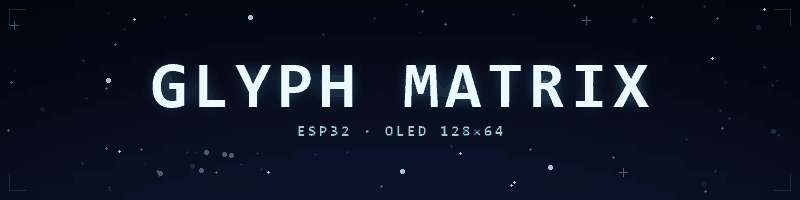

<p align="center">
  
</p>

**Русский** · [English version](README.md)

Прошивка для ESP32 и OLED 128×64 (SSD1306), вдохновлённая Nothing Glyph Matrix.
Рисует анимации по пиксельной сетке, показывает меню с шапкой-рамкой, снег или
звёзды на фоне, умеет хранить анимации в LittleFS и раздавать локальный сайт с
редактором для телефона.


## Возможности

- Анимации по сетке **25×25** или **64×64**.
- Меню с рамкой, иконкой раздела и стрелками по краям.
- Главный экран циклически переключает пункты: **Настройки → Информация → анимации**.
- Настройки: FPS (1…30), поворот 0/90/180/270, фон (снег/звёзды), сетка редактора,
  язык интерфейса.
- Экран информации: проект, плата, версия, сетка, FPS, Wi-Fi, адрес сайта, память.
- Информация об анимации: имя, FPS, число кадров и длительность по формуле `кадры / FPS`.
- Воспроизведение: анимация по центру, информация по кнопке «вверх», пауза по «вниз»,
  остановка по **OK**.
- Локальная точка доступа и сайт: загрузка, удаление, скачивание и запуск анимаций.
- HTML-редактор для телефона: рисование, ластик, круглая кисть, фигуры (круг,
  квадрат, прямоугольник, овал), инверсия кадра, кадры, предпросмотр,
  сохранение на устройство и скачивание `.anim`.
- Встроенные анимации `PULSE`, `WAVE`, `SCAN`, `SPIRAL` создаются при первом запуске.
- Веб-страницы вшиты в прошивку — отдельная загрузка файловой системы не нужна.
- Интерфейс устройства, сайт и редактор работают на **английском (по умолчанию)
  и русском**.

## Железо

**Проверено на ESP32 DOIT DevKit v1** (`esp32doit-devkit-v1` в
`platformio.ini`): именно на этой плате прошивка разрабатывалась, прошивалась и
запускалась. Подойдёт любая плата ESP32 с теми же выводами.

### Что понадобится

| Компонент | Кол-во | Примечание |
|---|---|---|
| ESP32 DOIT DevKit v1 | 1 | проверенная плата; USB-порт для прошивки |
| OLED 0.96", SSD1306, I2C, 128×64 | 1 | 4 пина: GND, VCC, SCL, SDA; адрес `0x3C` |
| Модуль зарядки TP4056 | 1 | заряжает аккумулятор от USB; берите версию с защитой |
| Повышающий преобразователь 3.7 → 5 В (MT3608 или аналог) | 1 | питает девитку от аккумулятора |
| Аккумулятор Li-ion 18650 или LiPo 3.7 В | 1 | необязателен, нужен для автономной сборки |
| Тактовые кнопки 6×6 мм | 3 | вверх, вниз и OK |
| Провода и выключатель питания | — | выключатель между выходом повышайки и пином `5V` девитки |

Цепочка питания для автономной сборки:

```
питание:  USB-C ──► TP4056 ──► аккумулятор 3.7 В ──► повышайка 5 В ──► DevKit 5V/VIN ──► OLED 3.3 В
прошивка: USB-C ──► USB-порт девитки
```

USB в девитку нужен для прошивки. С аккумулятором включайте выключатель, чтобы
повышайка подавала питание на `5V`/`VIN`; не подавайте на пин `5V` одновременно
от USB и от повышайки.

### Распиновка

| Что | Пин ESP32 |
|---|---|
| OLED SDA | GPIO21 |
| OLED SCL | GPIO22 |
| Кнопка «вверх» | GPIO19 → GND |
| Кнопка «вниз» | GPIO23 → GND |
| Кнопка «OK» | GPIO18 → GND |

Кнопки работают с `INPUT_PULLUP`: второй контакт замыкается на GND.
OLED подключается по I2C, адрес обычно `0x3C`, питание 3.3 В.
Шина работает на 400 кГц.

При старте прошивка сама пробует оба порядка SDA/SCL, адреса `0x3C` и `0x3D`
и скорости 400/100 кГц, поэтому перепутанные SDA/SCL не мешают работе.

## Сборка и прошивка

Нужен [PlatformIO](https://platformio.org/) (CLI или расширение VS Code).

```powershell
pio run -t upload
pio device monitor
```

Или из VS Code: PlatformIO → Upload.

Плата в `platformio.ini`: `esp32doit-devkit-v1`, фреймворк Arduino.
Используется `default.csv` — около 1.4 МБ LittleFS под анимации.

Перед сборкой скрипт `scripts/embed_web.py` читает `web/index.html` и
генерирует `src/web_assets.h`. Меняйте стартовую страницу в `web/`,
не в сгенерированном заголовке. Редактор `editor.html` в прошивку не входит —
это отдельный файл для телефона.

## Wi-Fi и сайт

После загрузки устройство поднимает точку доступа:

- **Сеть:** `GlyphMatrix`
- **Пароль:** `glyph1234`
- **Сайт:** <http://192.168.4.1>
- **Имя в сети:** <http://glyph.local> (mDNS)

Подключите телефон к `GlyphMatrix`, откройте браузер и перейдите по адресу.
Эти же данные показываются на заставке устройства (окно закрывается кнопкой **OK**).

Чтобы подключить ESP32 ещё и к домашней сети, заполните `STA_SSID` и `STA_PASS`
в `src/config.h`. Тогда сайт будет доступен и по локальному IP.

### Стартовая страница

- Информация об устройстве, IP, памяти, прошивке и текущем экране.
- Пароль Wi-Fi (`AP_PASS`) и имя сети.
- Настройки FPS, поворота, фона, сетки и языка устройства.
- Список анимаций: играть, скачать, удалить.
- Загрузка файла `.anim` с телефона или компьютера.
- Переключатель языка **EN / RU** в шапке: базовый английский, русский
  включается кнопкой и запоминается в браузере. Этот переключатель меняет
  только сайт; язык устройства выбирается строкой **Язык устройства** ниже.

### Автономный редактор `editor.html`

Редактор больше не занимает место в прошивке. Файл `editor.html` лежит в корне
проекта: скопируйте его на телефон и открывайте в браузере даже без интернета.

- Поле **«Устройство»** — адрес ESP32, по умолчанию `http://192.168.4.1`.
- Рисование пальцем или мышью, кисти 1…4, ластик, очистка кадра.
- Отмена и повтор (до 40 шагов), горячие клавиши `Ctrl+Z`, `Ctrl+Y`, `B`, `E`, `Space`.
- Фигуры: круг, квадрат, прямоугольник, овал; круглая кисть и инверсия кадра.
- Кадры: добавить, скопировать, удалить, сдвинуть влево/вправо.
- Предпросмотр с настраиваемым FPS.
- Сетка 25×25 или 64×64 (смена сетки очищает кадры).
- **Сохранить** — отправляет `.anim` прямо на ESP32 (телефон должен быть в сети
  `GlyphMatrix`), **На устройстве** — сохраняет и сразу запускает.
- **Скачать .anim** — сохраняет файл на телефон; его можно загрузить через
  стартовую страницу устройства.
- Автосохранение рисунка в `localStorage` браузера.
- Переключатель языка **EN / RU** в шапке, выбор запоминается.

Для отправки на устройство в прошивке включены CORS-заголовки, поэтому
редактор может работать из локального файла `file://`.

## Главное меню

Главный экран: в верхней рамке — иконка и название выбранного пункта,
на фоне снег или звёзды.

Кнопками **вверх/вниз** переключаются пункты:

- **НАСТРОЙКИ**
- **ИНФО**
- все анимации из LittleFS: **PULSE**, **WAVE**, **SCAN**, **SPIRAL** и т. д.

В шапке для любого пункта-анимации написано **АНИМАЦИЯ**. Под пунктом
показывается имя конкретной анимации в рамке, без расширения файла
(например, `PULSE`, а не `PULSE.anim`). При загрузке нового
`.anim` через сайт или редактор пункт появляется в меню автоматически.

> Интерфейс на самом устройстве — английский по умолчанию. Откройте
> **НАСТРОЙКИ → ЯЗЫК** и нажмите **OK**, чтобы переключить на русский;
> выбор сохраняется в NVS. Все строки лежат в `src/ui.cpp` и `src/main.cpp`
> и переводятся на месте через helper `L(en, ru)` — встроенный шрифт уже
> содержит латиницу и кириллицу.

## Управление кнопками

| Экран | Вверх / Вниз | OK | Долгое OK |
|---|---|---|---|
| Главное меню | выбрать пункт | открыть / играть | открыть / играть |
| Настройки | выбрать строку | войти в редактирование | назад |
| Настройки (редактирование) | изменить активное значение | строка FPS: переключить FPS ↔ поворот; остальные строки: подтвердить и выйти | подтвердить и выйти |
| Информация | прокрутка | назад | назад |
| Воспроизведение | вверх — информация, вниз — пауза | остановить и выйти в меню | остановить и выйти в меню |

В настройках значение меняется после нажатия **OK**: FPS — по 1 кадру
(1…30), поворот — 0° → 90° → 180° → 270°, фон, сетка и язык — переключением
(английский ↔ русский).
При удержании кнопки FPS меняется медленно, примерно 5 значений в секунду.

**FPS и поворот занимают одну строку** (`FPS 24  ПОВ 0°`), чтобы сохранить
нормальный шаг строк. Нажмите **OK** — начнётся редактирование FPS, нажмите
**OK** ещё раз — переключение на поворот; меняйте активное значение кнопками
вверх/вниз, затем удерживайте **OK**, чтобы подтвердить и выйти.
Активное значение показывается в `<скобках>`, если они помещаются.

При повороте на 90° и 180° кнопки «вверх» и «вниз» меняются местами: та,
что при 0° была «вниз», становится «вверх». При 270° раскладка остаётся
как при 0°. Во время редактирования строки **ПОВОРОТ** кнопки всегда
работают по раскладке 0°.

## Формат `.anim`

Файл состоит из 16-байтового заголовка и кадров:

| Смещение | Размер | Поле |
|---|---|---|
| 0 | 4 | `GLYM` |
| 4 | 1 | версия (1) |
| 5 | 1 | ширина сетки (1…64) |
| 6 | 1 | высота сетки (1…64) |
| 7 | 1 | авторский FPS (0 = по умолчанию) |
| 8 | 1 | флаги (бит 0 — цикл) |
| 9 | 3 | резерв |
| 12 | 2 | число кадров, uint16 little-endian |
| 14 | 2 | резерв |
| 16 | … | кадры |

Кадр — битовая карта построчно: бит `y * width + x`, младший бит байта —
первый пиксель. Размер кадра: `ceil(width * height / 8)` байт.

Скорость воспроизведения на устройстве задаётся глобальной настройкой FPS.
FPS внутри файла используется редактором как авторское значение.

Ограничения: имя до 24 байт, до 512 кадров, файл до 256 КБ, сетка до 64×64.

## Масштаб на экране

- **25×25** рисуется с масштабом 2×2: один пиксель сетки = 4 пикселя OLED,
  то есть 50×50 точек по центру экрана.
- **64×64** физически не помещается в 128×64 с увеличением, поэтому выводится
  **1:1** (64×64 точки по центру). Это ограничение самого дисплея.

## Структура проекта

```
platformio.ini          сборка, зависимости, pre-script
scripts/embed_web.py    вшивание стартовой страницы в src/web_assets.h
web/index.html          стартовая страница
editor.html             автономный редактор для телефона (не в прошивке)
src/main.cpp            запуск, заставка, экран Wi-Fi
src/config.h            пины, Wi-Fi, лимиты
src/gfx.*               обёртка OLED и поворот
src/settings.*          настройки в NVS
src/anim.*              формат .anim, LittleFS, проигрыватель
src/background.*        снег и звёзды
src/buttons.*           антидребезг, клик, удержание, автоповтор
src/web.*               Wi-Fi AP, mDNS, API, загрузка файлов
src/ui.*                все экраны и обработка кнопок
src/font5x7.h           шрифт ASCII + кириллица
src/icons.h             иконки 8×8
tools/gen_assets.py     генератор шрифта и иконок
tools/make_banner.py    генератор звёздного баннера для README
assets/banner.gif       баннер README (генерируется)
```

## API

| Метод | Путь | Назначение |
|---|---|---|
| GET | `/api/info` | состояние и параметры устройства |
| GET | `/api/settings` | текущие настройки |
| POST | `/api/settings` | изменить `fps`, `rotation`, `background`, `grid`, `lang` |
| GET | `/api/animations` | список анимаций |
| GET | `/api/anim?name=NAME` | скачать файл |
| POST | `/api/anim` | загрузить `.anim` (multipart, поле `file`) |
| DELETE | `/api/anim?name=NAME` | удалить |
| POST | `/api/play?name=NAME` | играть на устройстве |
| POST | `/api/stop` | остановить |

## Если что-то не работает

- **Экран пустой.** Прошивка при старте сама перебирает порядок SDA/SCL,
  адреса `0x3C`/`0x3D` и скорости 400/100 кГц. Смотрите лог:
  `[OLED] display at 0x3C ...` или `[OLED] not found ...`. Если не найдено —
  проверьте питание 3.3 В, GND, целостность проводов и пайку пинов модуля.
  Если в логе `SDA/SCL swapped` — прошивка уже использует найденный порядок.
- **Кнопки не реагируют.** Проверьте, что кнопка замыкает пин на GND, а не на 3.3 В.
- **Сайт не открывается.** Убедитесь, что телефон подключён именно к `GlyphMatrix`.
  Если `glyph.local` не находится, используйте `192.168.4.1`.
- **Загрузка отклонена.** Файл должен быть корректным `.anim` (магия `GLYM`,
  версия 1). Неверный файл не заменяет уже сохранённую анимацию с тем же именем —
  сервер удаляет только временную копию.
- **Анимация тормозит.** Уменьшите FPS или размер сетки. Обновление всего
  экрана по I2C занимает около 23 мс, поэтому 30 FPS — практический предел.
- **Сброс настроек.** Настройки лежат в NVS; при необходимости очистите flash:
  `pio run -t erase`.

## Лицензия

MIT — см. [LICENSE](LICENSE). Проект можно свободно использовать, изменять,
форкать и распространять; ссылка на оригинал приветствуется.

Nothing Glyph Matrix — торговая марка Nothing Technology Limited.
Этот проект не связан с Nothing и является независимой реализацией идеи.

---

Создано через [OpenCode](https://opencode.ai) с помощью DeepSeek 4.1 Flash Free
(полностью вайбкод).
